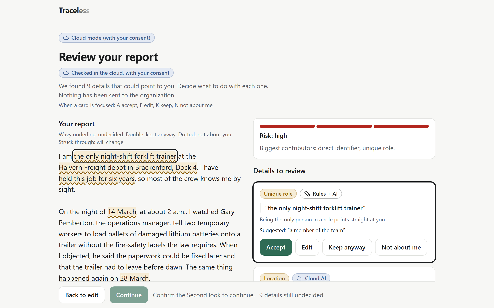
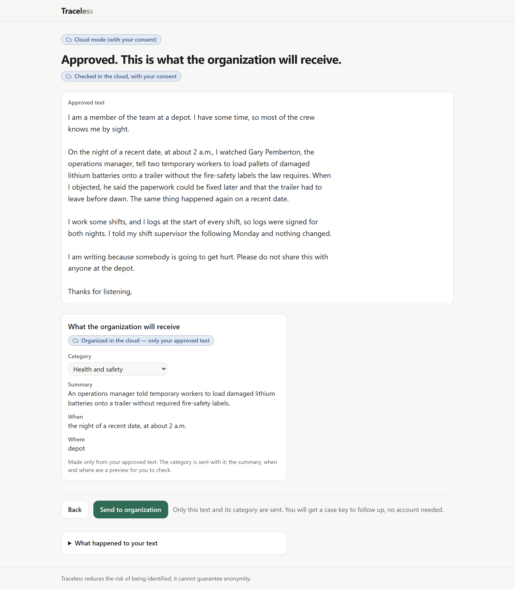
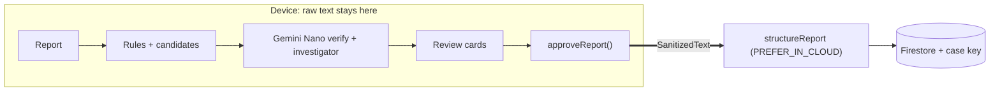

# Traceless

> For whistleblowers, Traceless finds the details in a report that could reveal who wrote it, on the device, before anything is sent. Only text the reporter has reviewed and approved ever reaches the cloud.

- **Live app (one click, no sign-up):** https://traceless-92f85.web.app
- **Demo video (3 min):** VIDEO_URL_TBD
- Built for the #BuildHybridAI hackathon (Devpost + Firebase), Web/Chrome track.




_(Screenshots: TBD, added before submission.)_

## The problem and who it is for

Anonymous reporting channels protect the sender. The report itself often gives the reporter away:
"the only night-shift nurse on Ward 3", "the Tuesday after my surgery", "I was the one who trained
the new hire". **Anonymity fails through content, not the channel.** A hotline can strip IP
addresses and still hand the employer a text that points at one person.

Traceless is for people about to report wrongdoing at work (fraud, safety, harassment) who want to
check their own text before it leaves their hands. The reasoning is simple: the text that needs the
most protection is exactly the text you do not want to upload to analyze. So the analysis runs on
the device, and the cloud only gets what the reporter approved.

This is a tool for the reporter's side. It does not promise anonymity; it shows what it found, lets
the reporter decide, and says plainly that the list may be incomplete (see
[Evaluation](#evaluation)).

## How it works

1. **Write or paste** a report (or load the invented sample report).
2. **On-device scan** (`ONLY_ON_DEVICE`): deterministic rules, grammar-based candidates, then
   Gemini Nano verifies each candidate and a second "HR investigator" pass asks what a colleague
   could deduce.
3. **Review**: every finding is a card. The reporter confirms, picks a safer rewrite, or dismisses
   it ("Not about me"). A mandatory second look follows. Nothing is changed silently.
4. **Approve**: `approveReport()` is the only way to create `SanitizedText`, the only type the cloud
   adapters accept.
5. **Cloud step on approved text only**: Gemini structures the report (category, summary, when,
   where). It is submitted to Firestore under a random 128-bit case key, which the reporter keeps to
   check the status later at `/case`.

### Hybrid inference strategy

The routing lives in one file, `src/ai/policy/inferencePolicy.ts`, and TypeScript rejects a raw-text
task with any mode but `ONLY_ON_DEVICE`. Shipped tasks:

| Task                    | Mode              | Data                             | Why                                                                                         |
| ----------------------- | ----------------- | -------------------------------- | ------------------------------------------------------------------------------------------- |
| `identityScan`          | `ONLY_ON_DEVICE`  | RAW                              | Raw report text is the most dangerous data; a silent cloud fallback would be a privacy bug. |
| `disclosureVerify`      | `ONLY_ON_DEVICE`  | RAW                              | Judging which phrases reveal the writer reads the raw report.                               |
| `structureReport`       | `PREFER_IN_CLOUD` | SANITIZED                        | Approved text only, so the stronger cloud model is fine; falls back on-device when offline. |
| `identityScanConsented` | `ONLY_IN_CLOUD`   | CONSENTED_RAW (one scan, opt-in) | For devices that cannot run Nano, only after an explicit consent dialog.                    |

Roadmap rows exist in the policy but are not shipped (see [Roadmap](#roadmap)). The UI shows where
each result was computed (on device or in the cloud) using the SDK's `inferenceSource`.

The full diagram and the file map are in [`docs/architecture.md`](docs/architecture.md). In short:



## Firebase products used and why

| Product                                  | Why                                                                                                          | Where                                                                                               |
| ---------------------------------------- | ------------------------------------------------------------------------------------------------------------ | --------------------------------------------------------------------------------------------------- |
| **Firebase AI Logic** (hybrid inference) | The core: Nano for raw text, cloud Gemini for approved text, explicit per-task routing, `inferenceSource` UI | `src/infrastructure/ai/aiService.ts`, `modelFactory.ts`, `hybridModel.ts`, `consentedCloudModel.ts` |
| **App Check** (reCAPTCHA Enterprise)     | Required for AI Logic; debug provider only in dev builds (a script fails CI if a token reaches `dist`)       | `src/infrastructure/firebase/appCheck.ts`                                                           |
| **Authentication** (anonymous)           | Reporters and judges never create an account; the anonymous uid lets rules allow "create and get by key"     | `src/infrastructure/firebase/anonymousAuth.ts`                                                      |
| **Firestore** + security rules           | Stores the approved report; reporters can never list, update or delete; rules tested on the emulator         | `src/infrastructure/firebase/reportSubmit.ts`, `firebase/firestore.rules`                           |
| **Remote Config**                        | Cloud-scan kill switch; acknowledgement (7 d) and feedback (90 d) deadlines per EU Directive 2019/1937       | `src/infrastructure/config/RemoteConfigService.ts`, `firebase/remoteconfig.template.json`           |
| **Hosting**                              | The live app, with a strict CSP and security headers                                                         | `firebase.json`                                                                                     |

## Evaluation

Detection quality is the product's weak point, so it is measured and the misses are disclosed rather
than hidden.

### Research basis

The design follows published work rather than ad-hoc rules: Microsoft **Presidio** (layered pattern,
NER and context detection); **TAB** (Pilan, Lison et al., Computational Linguistics 2022) and
Lison et al. (ACL 2021) on span-level re-identification risk; **Papadopoulou et al.** (AACL 2022)
on disclosure-risk estimation; **Staab et al.** (ICLR 2025) on adversarial anonymization, where an
LLM plays the attacker (our "HR investigator" pass); **Dou et al.** (ACL 2024) on self-disclosure
detection; and **RECAP** (2025) and PII-Bench on candidates plus LLM verification, with the warning
that small models degrade on complex prompts (so each Nano call is short and single-purpose).

### Metric

Strict recall = gold identifying spans matched by a finding that is not oversized for that span,
out of all gold spans. A scan that fails or hangs counts as **missed**. The ACCUSED violation rate is
the share of "must not flag" spans about an accused person that the detector flagged anyway. Both are
pooled over 3 runs. Gate thresholds: strict recall >= 0.70, ACCUSED <= 0.05, INCIDENT_FACT <= 0.10,
precision >= 0.35, median scan <= 20 s, slowest <= 60 s. Confidence intervals are per-report
bootstrap (10,000 resamples, fixed seed): `npm run eval:bootstrap -- <result file>`.

### Measurement 1: v1 test split (16 reports), commit `b065f9c`

Detector `v2-single2-rules`, 3 runs. Result file:
`eval/results/v2-single2-rules-test-2026-11-16T19-33-33.723Z.json`.

| Metric                | Pooled          | 95% CI (bootstrap) | Worst run |
| --------------------- | --------------- | ------------------ | --------- |
| Strict recall         | 0.604           | 0.508 to 0.721     | 0.566     |
| ACCUSED violation     | 0.046           | 0.000 to 0.126     | 0.069     |
| INCIDENT_FACT         | 0.030           |                    |           |
| Precision             | 0.656           |                    |           |
| Median / slowest scan | 10.2 s / 36.7 s |                    |           |

Gate **not met** (recall below 0.70). Decision recorded then: ship with the disclosed miss, make the
second look mandatory, and never imply the list is complete. This split was used once; fixes made
afterwards came from testing in the browser, and they changed the detector after this measurement
(this number is for `b065f9c` only).

### Measurement 2: fresh held-out split (22 reports, 87 gold spans)

After measurement 1 the team tried to improve recall to 0.70. To avoid tuning on seen data:

- A **new test split** (`reports.v2`, 22 reports, 87 gold spans) was written by a separate LLM
  author agent that was blind to the rules, prompts, results and the discussion. Its SHA-256 was
  committed before any detector change:
  `66435e6ce2036074e037535df064f97619eb3c0ec10e0423182d6e9030e55662`.
- The old v1 data (24 reports) became the development pool.
- The thresholds were **not changed**, and the test split ran **once** (3 runs), publishing
  whatever came out.

Detector `v3-verifier+investigator` (rules + compromise candidates + Nano verifier + investigator
pass). Result file: `eval/results/v3-verifier+investigator-v2test-2026-11-17T14-44-38.337Z.json`.

| Metric                          | Pooled          | 95% CI (bootstrap) | Worst run | Threshold                                                           |
| ------------------------------- | --------------- | ------------------ | --------- | ------------------------------------------------------------------- |
| Strict recall (failed = missed) | **0.709**       | 0.642 to 0.784     | 0.655     | >= 0.70, met, but unstable                                          |
| ACCUSED violation               | **0.072**       | 0.033 to 0.117     | 0.088     | <= 0.05, **not met**                                                |
| INCIDENT_FACT violation         | 0.070           |                    | 0.103     | <= 0.10, met                                                        |
| OTHER_PERSON violation          | 0.103           |                    |           | none                                                                |
| Precision                       | 0.662           |                    | 0.655     | >= 0.35, met                                                        |
| Scan failures                   | 0.045           |                    | 0.136     | <= 0.05, met (3 terminal stalls, all in one run, counted as missed) |
| Median / slowest scan           | 14.3 s / 36.0 s |                    |           | <= 20 s / <= 60 s, met                                              |

Per-category recall: ROLE 0.86, SCHEDULE 0.81, LOCATION 0.84, DATE 0.71, TRAIT 0.77, TEAM 0.86,
DIRECT_ID 1.00.

**Outcome: conditional go.** Recall reached the target, but ACCUSED sits in the pre-registered
conditional band (0.05 to 0.15), so the product ships only with the confirmation UI described below.
It is ~1 span away from the 0.05 guard at this sample size, and the bootstrap interval includes both
sides of it.

### Pre-registration and one recorded deviation

Before running the new variants, the selection rule was written down (best strict recall subject to
the guards above, on the development pool). On the development pool (24 reports x 3 runs, commit
`abc061a`):

| Variant                       | Strict recall | ACCUSED | INCIDENT | Precision | p50 / max       |
| ----------------------------- | ------------- | ------- | -------- | --------- | --------------- |
| v2-single2-rules (previous)   | 0.561         | 0.061   | 0.074    | 0.650     | 10.1 s / 44.8 s |
| v3-base+investigator          | 0.689         | 0.054   | 0.112    | 0.553     | 12.7 s / 46.3 s |
| v3-verifier+investigator      | 0.731         | 0.068   | 0.089    | 0.587     | 12.7 s / 41.5 s |
| v3-base+verifier+investigator | 0.716         | 0.048   | 0.109    | 0.567     | 18.4 s / 58.1 s |

Read literally, **no variant was eligible**: the previous detector itself failed the ACCUSED guard
(0.061 > 0.05), which the rule had not anticipated. The recorded deviation: a guard that the
baseline also fails becomes a **non-inferiority** test (tolerance about one span per report-run);
all other guards stay absolute. Only `v3-verifier+investigator` remained eligible (the other two v3
variants fail INCIDENT, which the baseline passes), and it was chosen on the development pool, not on
the test split. An abort rule was also fixed in advance: if the pooled ACCUSED on the test split
exceeded 0.15, the product would keep the previous detector. It did not (0.072).
Full record: `docs/progress/DECISIONS.md` (in Portuguese).

### Things not measured, and a late change

- **The baseline reference on the new split is lost.** Re-running `v2-single2-rules` on the new test
  split in the same browser session failed all 66 scans with a terminal `OnDeviceStuck` (the
  per-page stall limit had been reached by the previous run). That is not a measurement of the
  detector, so it is not used in any comparison. The file is kept as evidence:
  `eval/results/v2-single2-rules-v2test-2026-11-17T14-44-38.406Z.json`. Comparisons between the old and
  new detector therefore rest on the development pool only.
- **Commit `665f14b` came after the measurement.** It drops rewrite suggestions that would sign the
  report again. It changes suggestions only, not the detected spans, so the numbers above still apply to detection. (The run used the eval
  variant at `abca22c`; the product adopted the identical definition in `23c5f23`, enforced by a
  test that the shipped pipeline equals the eval variant.)
- **ACCUSED mitigation in the UI.** Every finding is a card the reporter confirms, and "Not about
  me" dismisses a finding that is not about them, so a wrongly flagged accused person costs a click,
  not a silent edit.

### Limitations

- The datasets are **synthetic and written by an LLM**; real reports are messier. Held-out n = 22
  reports (87 gold spans), so the intervals are wide (recall CI about +/- 0.07).
- English only (Gemini Nano supports en, es, ja, de, fr; Portuguese is not supported).
- Chrome desktop only for on-device inference; everywhere else the cloud-scan path with consent is
  used.
- The detector will miss details. The product says so and never presents the list as complete.

## Try it

1. Open **https://traceless-92f85.web.app** in desktop Chrome. No account: you are signed in
   anonymously.
2. Click **Try a sample report** to load an invented report, then **Check my report**.
3. **Without Gemini Nano** (what most visitors have): the app explains this and offers a
   **consented cloud scan**: raw text goes to the cloud for that one scan only after you agree.
   Otherwise it offers the "Basic private check (patterns only, no AI)", which stays on the device.
4. **With Gemini Nano** the scan, and the badge "Checked on your device", appear without any raw
   text leaving the browser.

### Enabling Gemini Nano in Chrome

1. Desktop Chrome 139 or newer (Windows 10/11, macOS 13+, Linux or Chromebook Plus).
2. Go to `chrome://flags/#prompt-api-for-gemini-nano-multimodal-input`, set **Enabled**, restart.
3. Hardware (per Chrome's Prompt API docs): at least 22 GB free on the Chrome profile disk, and a
   GPU with more than 4 GB VRAM, or a CPU with 16 GB+ RAM and 4+ cores.
4. In the app, choose the on-device option; the first run downloads the model (several GB) with a
   progress bar. You can check `await LanguageModel.availability()` in DevTools; it should return
   `'available'`.

## Run locally

Requirements: **Node.js 24** (see `.nvmrc`), a Firebase project with AI Logic and App Check set up.

```bash
npm ci
cp .env.example .env.local     # fill in the Firebase web config and the reCAPTCHA key
npm run dev
```

- **App Check debug token (dev only):** run `npm run dev`, open the console, copy the token the SDK
  prints and register it under Firebase Console > App Check > Apps > Manage debug tokens. Put it, if
  you want to pin it, in `.env.development.local` (git-ignored). Never commit a token; CI runs
  `npm run verify:no-debug-token` against the build.
- **Without Firebase:** set `VITE_AI_MODE=fake` for deterministic fake AI, and `npm run emulators`
  with `VITE_USE_EMULATORS=true` for local Auth and Firestore.
- **Checks:** `npm run ci` (format, lint, unit and component tests, build, safety checks);
  `npm run test:rules` (Firestore rules on the emulator); `npm run test:e2e` (Playwright, fake AI;
  first `npm run test:e2e:install`).
- **Evaluation page:** `npm run eval` opens `/eval` (dev only; it is kept out of the production
  build). It runs the detector variants against the datasets in `eval/datasets` and downloads
  result files like those in `eval/results`. `npm run eval:inspect -- <file>` and
  `npm run eval:bootstrap -- <file>` read a result file.

## Tech stack

React 19.3.1, TypeScript 6.0.3, Vite 8.3.8, Tailwind CSS 4.3.5, React Router 8.5.1, Firebase JS SDK
13.3.0 (AI Logic, App Check, Auth, Firestore, Remote Config), compromise 14.20.0 (grammar
candidates, loaded on demand), zod 4.6.7 (model output validation), Vitest 5.1.0, Testing Library,
Playwright 1.65.1, ESLint 10.14.0, Prettier 3.10.1. Cloud model: `gemini-3.5-flash-lite`.

Hexagonal layout: `src/domain` (pure), `src/application` (use cases and ports),
`src/infrastructure` (Firebase, Chrome AI, NLP adapters), `src/features` (UI), `src/app`
(composition root).

## Roadmap

Cut to keep the scope small and the main flow polished; the routing for these is already decided in
`inferencePolicy.ts` but nothing ships them:

- Rights advice grounded with Google Search (`adviseRights`, cloud only).
- Investigator-side UI: triage and reply drafting (`triageCase`, `draftReply`) over approved text.
- Reporter follow-up chat (`caseChat`; multi-turn is not supported on-device, so cloud only).
- On-device writing-style neutralization (`styleNeutralize`).
- More languages as Gemini Nano gains them; Android with the same Firebase AI Logic SDK.
- Evaluation on real (consented) reports, and a larger held-out set.

---

Working notes (`PLANO.md`, `HACKATHON.md`, `docs/progress`) are in Portuguese; all product material
is in English.

## License

[Apache License 2.0](LICENSE)
