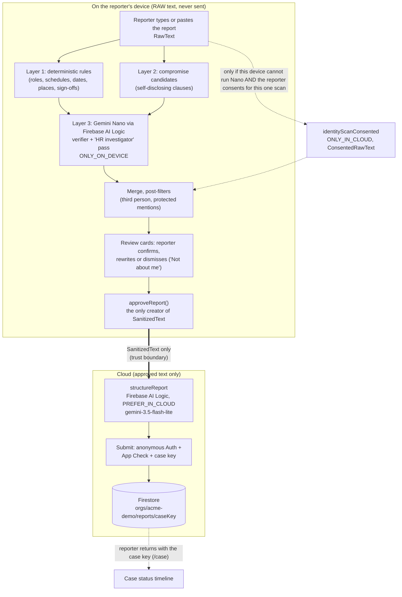

# Traceless architecture

Traceless is a hexagonal React app: `src/domain` is pure, `src/application` holds use cases and
ports, `src/infrastructure` holds the Firebase and Chrome adapters, and `src/features` (UI) only
sees services handed out by the composition root (`src/app/compositionRoot.ts`).

The one rule that shapes everything: **the raw report never leaves the device.** Raw text has its
own type (`RawText`); the cloud adapters accept only `SanitizedText`, and the only function that
creates it is `approveReport()` (`src/application/usecases/approveReport.ts`).

## 1. The reporter flow and the trust boundary

Notes on the diagram:

- The whole detection cascade (solid lines inside the device box) is on-device. Layers 1 and 2 are
  plain code (`src/domain/detection/ruleDetector.ts`, `src/infrastructure/nlp/compromiseCandidates.ts`).
  Layer 3 is the only model call over raw text (`src/infrastructure/ai/adapters/OnDeviceCandidateVerifier.ts`
  and `OnDeviceIdentityScanner.ts`), and its mode is `ONLY_ON_DEVICE`, never `PREFER_ON_DEVICE`,
  so there is no silent cloud fallback.
- The dotted consent path exists so that judges and users without Gemini Nano still get a working
  scan. It runs only after an explicit, per-scan consent dialog
  (`src/application/usecases/consentToCloudScan.ts`), uses a separate branded type
  (`ConsentedRawText`) and is pinned to `ONLY_IN_CLOUD`
  (`src/infrastructure/ai/consentedCloudModel.ts`). A Remote Config kill switch
  (`cloud_scan_enabled`) can turn this path off.
- `structureReport` runs on text the reporter already approved, so it prefers the cloud model
  (better structure). Offline, the Firebase SDK falls back to the on-device model.
- Every finding is a card the reporter confirms; the detector never edits the report by itself.

## 2. Routing table (shipped tasks)

Source of truth: `src/ai/policy/inferencePolicy.ts` (`INFERENCE_POLICY`, `shippedTasks()`). Types
make a RAW task with any mode other than `ONLY_ON_DEVICE` a compile error.

| Task                    | Mode              | Data class      | Why                                                                                                     |
| ----------------------- | ----------------- | --------------- | ------------------------------------------------------------------------------------------------------- |
| `identityScan`          | `ONLY_ON_DEVICE`  | `RAW`           | Raw report text is the most dangerous data; a silent cloud fallback would be a privacy failure.         |
| `disclosureVerify`      | `ONLY_ON_DEVICE`  | `RAW`           | Checking which candidate phrases reveal the writer reads the raw report, so it stays on the device.     |
| `structureReport`       | `PREFER_IN_CLOUD` | `SANITIZED`     | Approved, sanitized text only; the cloud model structures it better; falls back on-device when offline. |
| `identityScanConsented` | `ONLY_IN_CLOUD`   | `CONSENTED_RAW` | Only with explicit consent for one scan, when this device cannot run on-device AI.                      |

Roadmap rows (decided in the policy, `shipped: false`, **not in the product**):

| Task              | Mode             | Data class  | Why                                                             |
| ----------------- | ---------------- | ----------- | --------------------------------------------------------------- |
| `styleNeutralize` | `ONLY_ON_DEVICE` | `RAW`       | Rewriting the writing style still reads the raw report.         |
| `adviseRights`    | `ONLY_IN_CLOUD`  | `SANITIZED` | Google Search grounding is only available in the cloud.         |
| `triageCase`      | `ONLY_IN_CLOUD`  | `SANITIZED` | Handler-side triage needs long context over approved text only. |
| `draftReply`      | `ONLY_IN_CLOUD`  | `SANITIZED` | Handler-side reply drafting needs long context.                 |
| `caseChat`        | `ONLY_IN_CLOUD`  | `SANITIZED` | Multi-turn chat is not supported by the on-device model.        |

Every on-device model declares `expectedInputs` and `expectedOutputs` with `languages: ["en"]`
(Gemini Nano supports en, es, ja, de, fr; Traceless is English-only for now).

## 3. Firebase products and where each is called

| Product                        | What it does here                                                                                                               | Where                                                                                                                                                                                                        |
| ------------------------------ | ------------------------------------------------------------------------------------------------------------------------------- | ------------------------------------------------------------------------------------------------------------------------------------------------------------------------------------------------------------ |
| **Firebase AI Logic** (hybrid) | On-device Gemini Nano for raw text; cloud Gemini for approved text; `inferenceSource` shown in the UI                           | `src/infrastructure/ai/aiService.ts` (`getAI`), `src/infrastructure/ai/modelFactory.ts` and `hybridModel.ts` (`getGenerativeModel`, `initializeDeviceModel`), `src/infrastructure/ai/consentedCloudModel.ts` |
| **App Check**                  | reCAPTCHA Enterprise in production, debug provider in dev only; AI Logic uses limited-use App Check tokens                      | `src/infrastructure/firebase/appCheck.ts`, `src/app/firebaseBootstrap.ts`, `aiService.ts`                                                                                                                    |
| **Authentication** (anonymous) | "Continue as guest": a silent anonymous sign-in, no account for reporters or judges                                             | `src/infrastructure/firebase/anonymousAuth.ts`, `auth.ts`                                                                                                                                                    |
| **Firestore + rules**          | Stores the approved report under a 128-bit case key; reporters can create and get by key, never list, update or delete          | `src/infrastructure/firebase/reportSubmit.ts`, `firestoreReportRepository.ts`, `firestore.ts`; rules in `firebase/firestore.rules`, indexes in `firebase/firestore.indexes.json`                             |
| **Remote Config**              | Cloud-scan kill switch, and the acknowledgement and feedback deadlines (7 and 90 days, EU Directive 2019/1937) shown in `/case` | `src/infrastructure/config/RemoteConfigService.ts`, `src/infrastructure/firebase/remoteConfig.ts`; template in `firebase/remoteconfig.template.json`                                                         |
| **Hosting**                    | Live app, with a strict CSP and security headers                                                                                | `firebase.json`                                                                                                                                                                                              |

Design notes: the case key is a capability URL (`docs/adr/0003-case-key-capability-url.md`); the
app stores nothing about report content in the browser (`docs/adr/0005-no-persistent-client-storage.md`).
The cloud model name is pinned in code (`CLOUD_MODEL_NAME` in `inferencePolicy.ts`) rather than
read from Remote Config, so a remote switch can never change which model receives consented raw
text.
